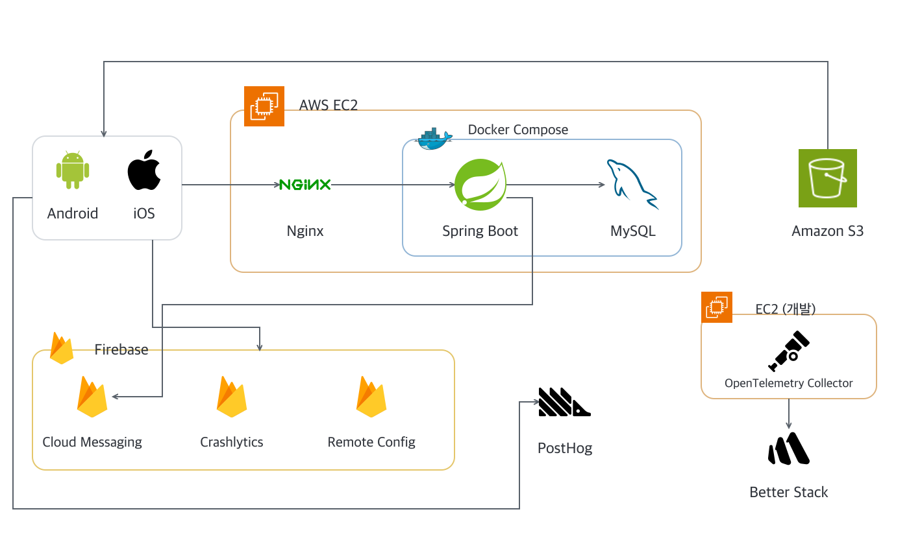
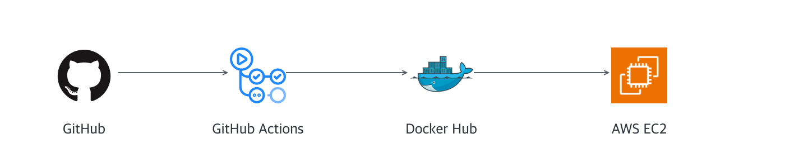
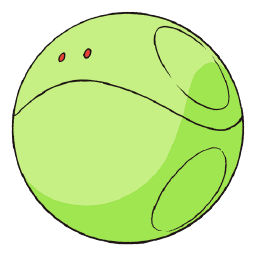

# 여백

같은 책을 읽는 사람들과 문장에 생각을 남기고 나누는 온라인 교환독서 서비스

  
  

## 서비스 소개

한 권의 책을 돌려 읽으며 문장 사이사이에 서로의 생각을 남기는 교환독서에는 특별한 즐거움이 있어요. 하지만 책을 직접 전달해야 하기에 멀리 사는 사람과 함께하기 어렵고, 차례를 기다려야 다른 사람의 메모를 다시 읽을 수 있죠. 나누고 싶은 이야기를 모두 담기에는 종이의 여백도 부족하고요.

**여백**은 이러한 아쉬움을 덜고, 더 자유롭게 생각을 나눌 수 있도록 만든 온라인 독서 공간이에요.

꼭 아는 사람과 함께하지 않아도 괜찮아요. 누구나 자유롭게 참여해 다양한 사람들과 책을 읽고, 인상 깊은 문장에 자신의 생각을 가볍게 남길 수 있어요. 다른 사람의 생각을 구경하고 공감하며 이야기를 나누다 보면, 혼자 읽을 때는 미처 발견하지 못했던 새로운 시선과 독서의 즐거움을 만날 수 있을 거예요.

## 기술 스택

### 모바일

  
  
  
  
  

### 백엔드

  
  
  
  
  
  
  
  
  
  
  
  

### 인프라

  
  
  
  
  
  
  

## 프로젝트 구조

| 폴더 | 내용 |
| :--- | :--- |
| [android](android/) | Android·iOS 앱과 공통 UI·로직 |
| [backend](backend/) | Spring Boot API 서버 |
| [translation](translation/) | 도서 번역 도구 |
| [docs](docs/) | 제품 요구사항, API 명세와 협업 지침 |
| [.github](.github/) | GitHub Actions 워크플로 |

## 프로젝트 아키텍처

### CI/CD

## 팀원

### 모바일

<table>
  <tr>
    <td align="left"></td>
    <td align="left"></td>
  </tr>
  <tr>
    <td align="left"><a href="https://github.com/noeyhoj">하로</a></td>
    <td align="left"><a href="https://github.com/eungyeong12">엘리</a></td>
  </tr>
</table>

### 백엔드

<table>
  <tr>
    <td align="left"></td>
    <td align="left"></td>
    <td align="left"></td>
  </tr>
  <tr>
    <td align="left"><a href="https://github.com/kjoon418">왓슨</a></td>
    <td align="left"><a href="https://github.com/alstj2384">제제</a></td>
    <td align="left"><a href="https://github.com/Yeji-Kim-Erica">테리</a></td>
  </tr>
</table>
