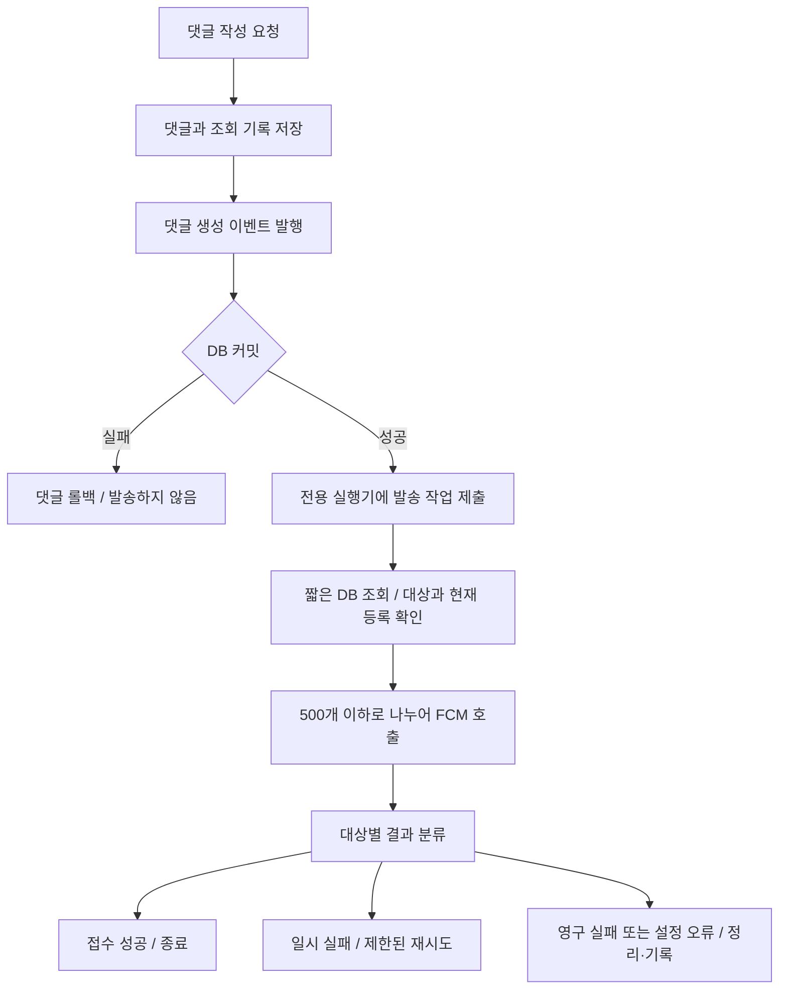
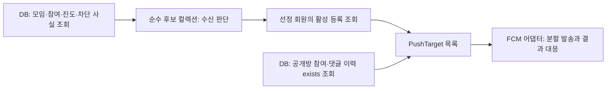
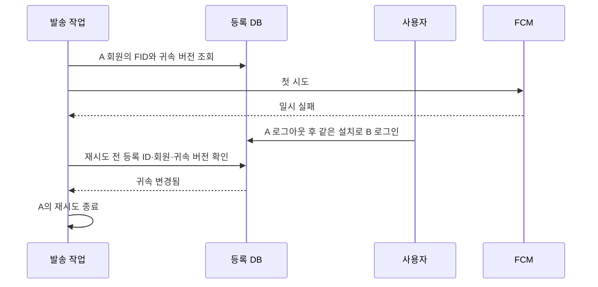

# FCM 도입 리뷰와 단계별 개선안

검토 기준: 2026-10-18, `feat/fcm` 브랜치의 스테이징·미스테이징 변경.

이 문서는 현재 코드에서 고칠 결함과 설계를 선택할 때 따져볼 조건을 정리한다. 예시 코드는 책임과 호출 순서를 설명하기 위한 축약본이다. 기존 소스에 그대로 붙여 넣어 실행하는 완성 코드는 아니다. 애플리케이션 코드는 이번 문서 작업에서 수정하지 않았다.

## 1. 현재 요구에서 출발하기

지금은 댓글 저장을 FCM 장애에서 분리하고 실패한 수신 대상만 식별하는 데 먼저 집중하는 편이 좋다. 누락을 허용하므로 처음부터 메시지 브로커나 outbox를 도입할 필요는 없다. 다만 등록 정보의 소유권은 처음부터 관리해야 한다. 재시도할 때 기기가 다른 계정으로 바뀌어 있으면 과거 회원의 알림을 보내지 않도록 하려는 것이다.

### 확정한 정책

| 항목 | 적용할 정책 |
|---|---|
| 댓글과 푸시 | 푸시 실패 때문에 댓글 저장이 실패하지 않도록 개선한다. |
| 발송 성공 | FCM이 메시지를 접수한 시점으로 판단한다. 기기 표시나 사용자 확인까지 뜻하지 않는다. |
| 지연·누락 | 30분 뒤 도착해도 유용하며 누락은 허용한다. |
| 이미 읽은 댓글 | 읽음 여부로 재시도를 취소하지 않는다. |
| 로그아웃 | 현재 설치의 회원 연결만 해제한다. 다른 기기의 알림 등록은 유지한다. |
| 차단 | **수신자가 댓글 작성자를 차단했다면 보내지 않는다.** 반대 방향의 차단까지 자동으로 제외하지 않는다. |
| 알림 빈도 | 우선 댓글마다 즉시 발송을 시도한다. 여러 댓글을 묶는 정책은 후속 논의로 남긴다. |

30분은 유용하다고 확인한 시간이다. 이 문서에서 제안하는 재시도 유효기간 30분과 시도 횟수는 확정 정책으로 정하기 전의 제안값이다. 즉시 발송은 첫 시도를 의도적으로 지연하지 않는다는 뜻으로 사용한다. 비동기 대기열이 밀리면 실제 접수는 늦어질 수 있다.

### 추천하는 첫 구조



실행기와 재시도 대기열은 우선 메모리에 둔다. 재시작하면 대기 작업이 사라질 수 있으며 누락 허용 정책 안에서 이 비용을 받아들이는 제안이다. 저장된 댓글을 이용해 사용자는 앱에서 내용을 확인할 수 있다.

## 2. 현재 당장 수정해야 하는 결함

### 2.1. 호출 계약을 맞춰 컴파일부터 복구한다

`CommentService.create()`는 정의되지 않은 `ClubCommentEvent`를 생성한다. 공개방 호출부는 ID를 넘기지만 알림 서비스는 `PublicRoom`, `Sentence`, `Member`를 받는다. 이전 리뷰에서 실행한 `./gradlew compileJava --offline --console=plain`은 이 두 오류로 실패했다. 예외 계약도 호출부와 함께 정리해야 한다.

이벤트로 옮길 계획이라면 임시로 엔티티 인자를 맞췄다가 다시 바꾸기보다 댓글 생성 사실을 나타내는 이벤트를 먼저 정의하는 편이 작업을 덜 반복한다. 이벤트에는 비동기 작업에 필요한 ID와 발생 시각을 넣는다. JPA 엔티티와 지연 로딩 프록시는 전달하지 않는다.

### 2.2. 커밋 전에 보내는 흐름을 끊는다

현재는 댓글 트랜잭션 안에서 FCM을 호출한다. FCM 예외를 런타임 예외로 바꾸면 댓글이 롤백되고 FCM 접수 후 DB 커밋이 실패하면 저장되지 않은 댓글의 알림이 간다. 외부 호출을 기다리는 동안 DB 트랜잭션도 길어진다.

알림 서비스에 기본 `@Transactional`을 더 붙여도 호출자의 트랜잭션에 참여한다. 발송 메서드를 `REQUIRES_NEW`로 바꾸는 것만으로도 해결되지 않는다. 바깥 댓글 트랜잭션이 아직 커밋하지 않은 시점에 푸시를 보낼 수 있기 때문이다.

댓글 트랜잭션에서 이벤트를 발행하고 `AFTER_COMMIT`에서 발송 작업을 제출한다. `AFTER_COMMIT`과 비동기는 별도 선택이다. 커밋 후 동기 리스너에서 직접 FCM을 호출하면 요청 스레드는 계속 기다린다. [Spring의 트랜잭션 이벤트 설명](https://docs.spring.io/spring-framework/reference/data-access/transaction/event.html)

### 2.3. FID의 유일성과 계정 귀속을 함께 고친다

현재 등록 서비스는 요청마다 새 행을 저장한다. 같은 회원의 반복 등록도 쌓이고 같은 FID가 서로 다른 회원에 연결될 수도 있다. 발송 직전의 `Set`은 한 번의 중복 발송만 줄인다. 잘못된 소유권과 중복 행은 그대로 남는다.

단일 Firebase 프로젝트라는 현재 전제에서는 FID에 DB 유일성 제약을 두는 방향을 권한다. `UNIQUE(member_id, fid)`만 두면 다른 회원에게 같은 FID를 등록할 수 있으므로 충분하지 않다. 여러 프로젝트를 한 DB에서 운영하게 된다면 프로젝트와 FID를 함께 식별해야 한다.

등록 동작은 다음처럼 정한다. 같은 회원·같은 FID의 반복 요청은 멱등하게 처리한다. 같은 FID로 다른 회원이 로그인하면 인증된 계정 전환 절차에 따라 귀속을 바꾼다. 동시 등록은 DB 유일성 제약과 원자적인 갱신으로 처리하고 제약 위반을 그대로 500 응답으로 노출하지 않는다. FID 문자열을 안다는 사실만으로 계정 전환을 허용하지 않도록 등록 요청의 인증 경계도 확인한다.

로그아웃은 인증된 `memberId`와 현재 FID를 함께 조건으로 연결을 해제한다. 탈퇴는 그 회원의 모든 등록을 회원 삭제보다 먼저 정리한다. 현재 매핑대로 FK를 생성하면 이 정리가 없는 회원 탈퇴는 참조 무결성 오류로 실패할 수 있다.

### 2.4. 부분 실패를 반환값으로 처리한다

`FcmPushSender.send()`는 이미 `BatchResponse`를 반환한다. 현재 알림 서비스가 그 값을 버리고 있다. 응답이 없는 설계라기보다 받은 응답을 처리하지 않는 상태다.

일부 대상의 실패와 전부 실패한 결과가 `BatchResponse`로 돌아올 수 있다. 반환된 항목을 모두 확인하고 호출 자체의 예외도 별도로 처리해야 한다. 응답 순서는 메시지에 넣은 대상 순서와 대응하므로 요청용 목록을 고정하고 그 목록으로 결과를 연결한다. [FirebaseMessaging 반환 계약](https://firebase.google.com/docs/reference/admin/java/reference/com/google/firebase/messaging/FirebaseMessaging)

### 2.5. 모임 알림에 차단 조건을 추가한다

최종 정책은 수신자가 작성자를 차단했으면 보내지 않는 것이다. 현재 공개방 쿼리는 이 방향에 맞다. 모임 알림은 진도와 작성자 본인 제외만 확인하므로 조건을 추가해야 한다.

```sql
-- recipient는 수신 후보 회원이다.
and not exists (
    select 1
    from member_blocks block
    where block.blocker_id = recipient.member_id
      and block.blocked_id = :writerId
)
```

작성자가 수신자를 차단한 사실만으로 제외하는 조건과는 방향이 다르다. 두 회원의 위치를 뒤집은 테스트를 따로 둬야 실수를 잡기 쉽다.

### 2.6. 500개 한도를 발송 경계에서 지킨다

현재 메시지 팩토리는 모든 FID를 한 번에 넣는다. 멀티캐스트 한 건은 FID와 토큰을 합해 최대 500개다. 수신 회원 수가 아니라 설치 수를 기준으로 나누어야 한다. 회원 한 명이 여러 기기를 사용할 수 있기 때문이다. [멀티캐스트 빌더 명세](https://firebase.google.com/docs/reference/admin/java/reference/com/google/firebase/messaging/MulticastMessage.Builder)

분할은 FCM 호출을 맡은 쪽의 책임으로 둔다. 도메인 컬렉션에 Firebase의 500개 제한을 넣을 필요는 없다. 앞 배치가 접수된 뒤 다음 배치가 실패하더라도 앞 배치를 다시 보내지 않도록 배치별 결과를 남긴다.

### 2.7. 배포와 테스트가 기동할 조건을 준비한다

운영 프로파일은 `ddl-auto=validate`다. 새 등록 테이블의 생성 DDL과 유일성 제약·회원별 조회 인덱스를 배포 절차에 포함해야 한다. 기존 중복 데이터가 있다면 소유권 정리 후 제약을 추가한다.

운영 Compose에는 Firebase 프로젝트 설정과 자격 증명 전달이 없다. 서비스 계정 파일을 사용한다면 읽기 전용 마운트와 컨테이너 내부 경로를 함께 설정하고 다른 인증 방식을 쓰면 해당 실행 환경에서 ADC가 자격 증명을 찾는지 확인한다. 비밀값을 이미지나 저장소에 넣지 않는다.

테스트에서는 실제 Firebase 인증 없이 기동할 수 있도록 SDK 빈 생성을 끄고 대체 발송기를 주입한다. 끄는 설정만 추가하고 필수 주입 대상인 `FirebaseMessaging`을 없애면 다른 빈 생성이 실패할 수 있다. SDK 설정과 발송 구현의 조건을 함께 맞춰야 한다. 운영에서 FCM을 켰는데 설정이 틀린 경우에는 조용히 가짜 성공으로 처리하지 않는다.

## 3. DB 조회와 도메인 처리의 경계

### 3.1. 현재 두 흐름이 다른 방식을 사용한다

모임은 참여 회원과 진도를 조회한 뒤 `ClubMembers.otherMembersAheadOf()`로 메모리에서 후보를 고르고 해당 회원들의 등록을 다시 조회한다. 공개방은 참여 이력·댓글 이력·차단을 쿼리에서 확인해 FID만 반환한다.

두 방식을 억지로 같게 만들 필요는 없다. 모임의 후보 수가 작고 상한이 있다면 컬렉션 판단을 읽고 테스트하기 쉽다. 공개방에서 과거 댓글 전체를 엔티티로 가져와 후보를 고르면 댓글 수에 따라 전송량과 메모리 사용량이 커진다. 존재 여부만 필요하면 DB의 `exists` 조회가 맞는다. 현재 후보 규모와 실행 계획을 측정하지 않았으므로 어느 방식이 더 빠르다고 단정할 근거는 없다.

| 방식 | 유리한 조건 | 감수할 비용 |
|---|---|---|
| DB에서 필터링하고 FID만 반환 | 조건이 단순하고 결과를 곧바로 한 번 발송할 때 | 소유권 확인·대상별 실패 처리에 필요한 정보를 다시 조회해야 한다. |
| 엔티티를 넓게 조회하고 컬렉션에서 판단 | 후보 수가 작고 이미 필요한 연관관계를 조회할 때 | 엔티티 생성·지연 로딩·불필요한 열과 행 조회를 관리해야 한다. |
| DB에서 범위와 사실을 조회하고 순수 객체로 판단 | 관계 조회는 무겁고 제품 규칙은 자주 바뀔 때 | 프로젝션과 정책 객체를 추가하고 두 경계의 테스트를 나눠야 한다. |

지금은 세 번째 방식을 모임 알림에 적용하는 절충안을 권한다. 공개방의 `exists` 조회는 유지하되 반환값은 FID 문자열보다 정보가 있는 발송 대상 프로젝션으로 바꾼다.

### 3.2. DB는 관계를 찾고, 도메인은 필요한 사실로 판단한다

DB에서 현재 모임에 참여 중인 회원 중 작성자를 제외하고 수신자가 작성자를 차단했는지 확인한다. 도메인에는 판단에 필요한 값만 전달한다. 다음 예시는 범위를 이미 좁힌 후보를 가정하며 읽기 진도는 현재 구현의 엄격한 `>` 조건을 유지한다.

```java
// 제안하는 순수 판단 모델. JPA 엔티티와 별개다.
record ReaderCandidate(
        Long memberId,
        ContentSequence lastReadSequence,
        boolean blockedWriter
) {
    boolean canReceive(ContentSequence commentSequence) {
        return !blockedWriter
                && lastReadSequence != null
                && lastReadSequence.isAfter(commentSequence);
    }
}

final class ReaderCandidates {
    private final List<ReaderCandidate> values;

    ReaderCandidates(List<ReaderCandidate> values) {
        this.values = List.copyOf(values);
    }

    List<Long> eligibleMemberIds(ContentSequence commentSequence) {
        return values.stream()
                .filter(candidate -> candidate.canReceive(commentSequence))
                .map(ReaderCandidate::memberId)
                .toList();
    }
}
```

`blockedWriter`는 후보 한 명마다 SQL을 실행해서 채우지 않는다. 후보 조회의 상관 서브쿼리나 한 번의 차단 목록 조회로 준비한다. 활성 등록이 없는 회원까지 모두 가져오는 비용이 커지면 DB에서 등록 존재 여부도 좁힌다.

이 구조에서는 DB가 차단 관계라는 사실을 찾고 객체가 그 사실을 수신 여부에 반영한다. 기존 도메인 모델링 지침의 판단 책임과도 맞는다. 재사용할 판단이 없고 조건이 안정적이라면 차단 제외를 SQL에 직접 넣는 선택도 가능하다. 그 경우 쿼리가 제품 규칙을 구현한다는 사실을 인정하고 실제 DB 테스트로 검증한다. 모든 조건을 Java와 SQL 양쪽에 똑같이 구현하면 두 규칙이 어긋날 수 있으므로 기준을 하나로 둔다.

### 3.3. 최종 조회 결과에는 FID보다 조금 더 남긴다

```java
// 모든 예시에서 공통으로 사용하는 발송 대상 스냅샷.
record PushTarget(
        Long registrationId,
        Long memberId,
        FirebaseInstallationId fid,
        long bindingVersion
) {}
```

`bindingVersion`은 회원 귀속이나 활성 상태가 바뀔 때 증가시키는 제안 필드다. 현재 엔티티에는 없다. FID만 받으면 어느 회원의 등록이었는지, 재시도 전에 소유권이 바뀌었는지 구분하기 어렵다. `PushTarget` 정도의 프로젝션이면 전체 `Member` 엔티티를 올리지 않고도 실패 결과와 등록 정리를 연결할 수 있다.

회원 수와 설치 수는 구분한다. 100명의 후보에게 기기가 150개 등록되어 있으면 발송 단위는 150개다. 재시도 상태도 설치별로 관리해야 이미 접수된 다른 기기에 다시 보내는 일을 줄일 수 있다.



### 3.4. DB로 더 옮길 시점은 측정해서 정한다

후보를 2,000명 읽어 10명만 남기는 상황이 반복된다면 등록 존재 여부나 진도 조건을 DB로 밀어 넣을 근거가 된다. 이 수치는 설명용 예시이며 현재 서비스의 측정값은 아니다. 조건을 밀어 넣더라도 외부의 조회 계약은 `findTargets(context)`처럼 유지할 수 있다.

후보 수, 최종 설치 수, 조회 시간, 실행 SQL 수, 할당 메모리를 확인한다. 공개방의 `exists`는 실행 계획에서 `public_room_id`·`member_id`, 문장·작성자 조건, 차단 관계, 등록의 `member_id` 인덱스를 살핀다. 실제 계획을 보지 않고 모든 조합의 인덱스를 추가하지 않는다.

질문: 후보 수에 제품 상한이 있는가? 후보 대부분이 제외되는가? 진도 규칙을 다른 기능에서도 사용하는가? 테스트하기 쉬운 판단을 위해 엔티티 전체를 가져올 필요가 있는가? 이 답으로 조회 범위를 좁히는 편이 성능과 모델링 중 하나를 원칙으로 고르는 것보다 낫다.

## 4. 고민해 볼 만한 지점

### 4.1. 실패 건을 별도 이벤트에 넣는 제안은 적절한가

실패 결과와 재시도 결정을 분리하는 방향은 적절하다. 다만 이벤트는 발생한 사실이고 재시도 작업은 실행할 일을 담는다. 이벤트를 발행했다는 사실만으로 작업이 보관되거나 정해진 시각에 실행되지는 않는다.

처음에는 발송 결과를 `RetryPlanner`에 직접 넘겨도 충분하다. 소비자가 하나인데 실패마다 Spring 이벤트와 리스너를 추가하면 흐름을 따라가는 비용이 더 클 수 있다. 재시도 외에 운영 집계나 다른 후속 처리가 필요해졌을 때 `PushAttemptFailed` 같은 사실 이벤트를 추가한다.

| 표현 | 역할 | 예시 |
|---|---|---|
| 생성 이벤트 | 댓글이 저장되었다는 사실 | `CommentCreated` |
| 발송 결과 | 이번 시도의 대상별 성공과 실패 | `PushBatchResult` |
| 재시도 작업 | 누구에게 언제 다시 시도할지 | `RetryPushTask` |

```java
record RetryPushTask(
        UUID notificationId,
        PushTarget target,
        int nextAttempt,
        Instant nextAttemptAt,
        Instant expiresAt
) {}

interface RetryScheduler {
    boolean trySchedule(RetryPushTask task);
}
```

위 `notificationId`는 이벤트를 만들 때 한 번 정하고 재시도에도 유지한다. 작업에는 같은 알림을 재구성할 문맥도 필요하다. 이 예시는 그 필드를 생략했다. `trySchedule()`이 `false`를 반환하면 누락 건수를 기록한다. 스케줄러 내부 대기열도 제한해야 하며 발송 실행기에만 한도를 둬서는 충분하지 않다.

### 4.2. 발송 결과는 안정적인 목록에 연결한다

```java
// FCM 어댑터 내부의 축약 예시. classify()는 오류별 분류 함수다.
List<PushTarget> ordered = List.copyOf(targets);

for (int offset = 0; offset < ordered.size(); offset += 500) {
    List<PushTarget> batch = List.copyOf(
            ordered.subList(offset, Math.min(offset + 500, ordered.size())));

    MulticastMessage message = MulticastMessage.builder()
            .addAllFids(batch.stream().map(t -> t.fid().value()).toList())
            .setNotification(notification)
            .build();

    try {
        BatchResponse response = messaging.sendEachForMulticast(message);
        List<SendResponse> outcomes = response.getResponses();
        if (outcomes.size() != batch.size()) {
            throw new IllegalStateException("발송 대상 수와 결과 수가 다릅니다.");
        }
        for (int i = 0; i < batch.size(); i++) {
            resultHandler.handle(batch.get(i), classify(outcomes.get(i)));
        }
    } catch (FirebaseMessagingException exception) {
        // 응답이 없는 실패다. 이전에 처리한 배치까지 재시도하지 않는다.
        resultHandler.handleUnconfirmedBatch(batch, exception);
    }
}
```

`Set`을 반드시 금지할 필요는 없다. 중복 제거에 사용한 뒤 요청과 결과를 대응시킬 목록을 한 번 고정하면 된다. 중복 FID의 소유권 충돌은 이 단계에서 조용히 제거할 문제가 아니므로 등록 단계에서 막는다.

응답이 확인된 97개는 끝내고 실패한 3개만 분류한다. 세 개 중 하나가 등록 무효이고 둘이 일시 장애라면 재시도 작업은 두 개다. 응답이 없는 타임아웃은 다른 경우다. FCM이 일부 또는 전부를 접수했는지 확정할 수 없으므로 다시 보내면 중복될 수 있다.

### 4.3. 재시도 정책의 초기 제안

다음은 팀이 조정할 초안이다. 처음 시도를 포함해 최대 4회, 댓글 생성 시각부터 30분까지만 시도한다. 대기 시간은 60초, 120초, 240초를 기준으로 무작위 지연을 더하고 서버가 지정한 대기 시간이 더 길면 그 시간을 지킨다. 이 간격과 횟수는 서비스 측 제안이며 Firebase의 필수 설정은 아니다.

| 결과 | 제안하는 처리 |
|---|---|
| FCM 접수 성공 | 해당 설치의 작업 종료 |
| 명확한 등록 무효 | 해당 시도의 등록과 귀속이 아직 같을 때만 비활성화 |
| `INVALID_ARGUMENT` | 잘못된 메시지 등 원인을 확인하고 자동 재시도 중단. 코드만 보고 등록을 삭제하지 않음 |
| `SENDER_ID_MISMATCH`·인증·권한 오류 | 설정 오류로 기록하고 반복 발송 중단. 등록을 일괄 삭제하지 않음 |
| `UNAVAILABLE`·`INTERNAL`·재시도 가능한 I/O 실패 | 유효기간과 횟수 안에서 재시도 |
| `QUOTA_EXCEEDED` | `Retry-After`와 할당량 제약을 고려해 예약 |
| 접수 여부 불명 | 중복을 감수해 제한적으로 재시도하거나 누락을 택하는 정책 결정 필요 |

초기에는 접수 여부 불명도 제한적으로 재시도하는 안을 제안한다. 누락을 허용하는 서비스이므로 중복 알림이 더 불편하다는 팀 판단이 나오면 이 유형만 재시도하지 않아도 된다. SDK 예외 한 종류가 모두 안전하게 재시도할 수 있다는 뜻은 아니다.

FCM은 지수 백오프와 무작위 지연을 권장한다. 429 응답에는 `Retry-After`를 존중하며 헤더가 없을 때의 권장 기본 대기는 60초다. Admin SDK 내부 재시도까지 고려해 총 호출 횟수와 소요 시간을 확인한다. `BatchResponse`의 설치별 예외에서 헤더를 얻을 수 없는 경우도 있으므로 실제 SDK 응답에서 얻는 정보와 기본 대기 정책을 구분한다. [FCM 재시도 권고](https://firebase.google.com/docs/cloud-messaging/scale-fcm), [오류 코드별 처리](https://firebase.google.com/docs/cloud-messaging/error-codes)

애플리케이션의 재시도 종료 시각과 기기에 전달되는 메시지의 TTL은 별도다. FCM이 접수한 후 오프라인 기기에 얼마나 보관할지도 제한하려면 플랫폼별 TTL을 설정하고 재시도 시에는 원래 종료 시각에서 남은 시간을 사용한다. 매 시도마다 새 30분을 부여하지 않는다. 30분 뒤 유용하다는 답만으로 TTL까지 30분으로 확정하지 않는다.

스레드를 `sleep()`시키며 기다리면 작업이 몰릴 때 실행기가 막힌다. 재시도 시각을 예약한 뒤 스레드를 반환한다. 접수 성공 뒤 프로세스가 죽으면 결과 기록을 잃을 수 있다. 이 경우까지 외부 FCM과 원자적으로 처리할 수는 없으므로 정확히 한 번 발송을 약속하지 않는다.

### 4.4. 로그아웃과 재시도가 겹치면 무엇을 확인하는가



최초 시도에서 실패한 설치를 재시도할 때 그 설치의 귀속이 같은지 확인한다. 이때 회원의 모든 FID를 다시 가져오면 이미 성공한 태블릿에도 다시 보낼 수 있다. 기존 실패 등록이 사라졌거나 버전이 달라졌다면 건너뛰는 쪽이 지금의 누락 허용 정책에 맞는다.

현재 차단 관계와 모임 참여 여부도 발송 직전에 다시 확인하는 편을 권한다. 이들은 읽음 취소와 다르다. 사용자가 알림을 받을 관계를 해제했는지 확인하는 절차다. 읽었는지를 검사하는 상태 관리는 추가하지 않는다.

다만 DB 확인 직후 로그아웃이 일어나거나 FCM에 이미 접수된 메시지가 뒤늦게 도착할 수 있다. 서버 조회만으로는 이런 경쟁까지 막을 수 없다. 잠금 화면에서 다른 계정의 내용이 보이는 일을 얼마나 엄격히 막을지는 앱과 별도 계약이 필요하다. 현재처럼 본문을 넣지 않은 일반 문구는 유지하고 필요하면 수신 회원 식별을 앱에서 검증하는 방식을 논의한다.

### 4.5. 진도 기준과 수신 대상의 의미

현재 `isAfter()`는 `>`다. 댓글과 같은 본문까지 읽은 사람은 제외되고 마지막 본문의 댓글은 더 뒤 본문이 없으므로 진도 조건으로는 누구도 선정되지 않는다. 이를 버그로 단정하기 전에 알림이 읽고 있는 본문에도 필요한지 확인해야 한다.

진도 갱신은 현재 위치를 덮어쓰는 구조다. 앞부분으로 돌아가면 과거에 더 뒤까지 읽었어도 대상에서 빠질 수 있다. 마지막 방문 위치와 최대 도달 진도를 구분할 필요가 있는지 팀에서 정한다. 또 모임은 앞서 읽은 회원 전체, 공개방은 같은 문장에 댓글을 쓴 회원이 대상이라는 차이도 제품 의도에 맞는지 확인한다.

## 5. 예시로 보는 호출 흐름과 책임

다음 구조는 현재 클래스들을 모두 새 추상화로 감싸지 않고 댓글 생성, 수신 판단, 외부 전송, 재시도 예약을 각각 바꿀 수 있도록 경계를 두는 예시다.

```java
record CommentCreated(
        UUID notificationId,
        Long commentId,
        CommentScope scope,
        Long scopeId,
        Long sentenceId,
        Long writerId,
        Instant occurredAt
) {}

enum CommentScope { CLUB, PUBLIC_ROOM }
```

기존 댓글 서비스는 검증과 저장을 유지하고 이벤트를 발행한다. `CommentView` 저장까지 같은 댓글 트랜잭션에서 처리한다. 새 이벤트의 시각은 일관된 `Clock`으로 만들고 재시도 동안 유지한다.

```java
@Transactional
public CommentResponse create(/* 기존 인자 */) {
    // 기존 문맥 검증, Comment 저장, CommentView 저장
    CommentCreated event = eventFactory.from(savedComment, clock.instant());
    eventPublisher.publishEvent(event);
    return CommentResponse.of(savedComment, memberId);
}
```

리스너는 커밋이 끝난 뒤 전용 실행기에 작업을 제출한다. 여기서는 `@Async` 대신 제출 코드를 직접 써서 대기열 초과를 처리할 위치를 드러냈다.

```java
// 생성자 주입과 로깅 도우미는 생략했다.
@Component
final class CommentCreatedListener {
    private final TaskExecutor notificationExecutor;
    private final CommentNotificationDispatcher dispatcher;

    @TransactionalEventListener(phase = TransactionPhase.AFTER_COMMIT)
    public void on(CommentCreated event) {
        try {
            notificationExecutor.execute(() -> {
                try {
                    dispatcher.sendInitial(event);
                } catch (RuntimeException exception) {
                    logFailure(event, exception);
                }
            });
        } catch (TaskRejectedException exception) {
            logDropped(event, "executor_full");
        }
    }
}
```

발송 작업이 실패해도 API 응답을 실패로 바꾸지 않는다. 그렇지 않으면 댓글은 커밋되었는데 클라이언트가 실패로 이해하고 다시 작성할 수 있다. 예시의 `RuntimeException` 처리는 작업 최상위의 마지막 기록 수단이며 정상적인 FCM 실패 분류와 재시도는 발송 결과 처리기가 맡는다.

실행기에는 유한한 스레드 수와 대기열을 둔다. 거절 정책은 `AbortPolicy`처럼 실패를 관측할 수 있는 방식으로 설정하고 위 위치에서 기록한다. `CallerRunsPolicy`를 쓰면 포화 상태에 댓글 요청 스레드가 FCM 호출을 떠맡을 수 있다. 예를 들어 스레드 2개와 대기열 200개로 시작할 수 있으나 이 수치는 부하 측정 전 가정이다. 스케줄러와 실행기가 동시에 처리하는 최대 발송량도 제한한다.

```text
CommentService
  └─ 댓글 저장 + CommentCreated 발행
CommentCreatedListener
  └─ 커밋 후 전용 실행기에 제출
CommentNotificationDispatcher
  ├─ RecipientResolver: 수신 회원과 활성 등록 조회
  ├─ FcmPushSender: 500개 분할, SDK 호출, 대상별 결과 변환
  └─ RetryPlanner: 재시도 여부와 시각 결정
       └─ RetryScheduler: 지연 실행 예약
```

기존 `FcmPushSender`와 `FcmMessageFactory`는 그대로 확장할 수 있다. 모임과 공개방을 선택하는 분기는 처음에는 한 곳의 `switch`로 충분하다. 알림 종류가 늘고 구현을 독립적으로 바꿀 필요가 생겼을 때 인터페이스를 추가한다. 순수한 재시도 정책은 `notification.domain`, 응용 흐름은 `notification.service`, SDK 연결은 `support.notification` 등 실제 의존성에 맞춰 배치한다. 모든 역할마다 별도 패키지를 만들지는 않는다.

대상 조회와 현재 귀속 확인은 별도 빈의 짧은 읽기 트랜잭션에서 마친 뒤 값 객체를 반환한다. 같은 클래스 내부 호출에 `@Transactional`을 붙이는 방식은 프록시를 거치지 않으므로 경계가 적용되지 않을 수 있다. 네트워크 발송을 조회 트랜잭션 밖에서 수행한다.

등록 비활성화나 시도 기록 저장은 별도 쓰기 트랜잭션에서 처리한다. 특히 동기 `AFTER_COMMIT` 리스너에 단순히 `@Transactional`을 붙인다고 새 쓰기 커밋이 보장되지는 않는다. 이미 완료된 트랜잭션 자원에 참여할 수 있으므로 독립된 트랜잭션 경계를 사용한다. [Spring의 커밋 후 자원 접근 주의사항](https://docs.spring.io/spring-framework/docs/current/javadoc-api/org/springframework/transaction/event/TransactionalEventListener.html)

## 6. 단계별 적용 순서와 완료 기준

| 단계 | 할 일 | 완료 기준 |
|---|---|---|
| 1. 안전하게 첫 발송 | 이벤트 계약 정리, 커밋 후 제출, 전용 실행기, 차단 반영, 부분 결과 처리, 500개 분할 | FCM 장애가 댓글 저장을 깨지 않고 대상별 실패를 확인한다. |
| 2. 배포 전 등록 정리 | FID 유일성·귀속 변경, 현재 설치 로그아웃, 탈퇴 정리, DDL·운영 인증·테스트 빈 | 계정 전환·탈퇴와 실제 배포 기동을 검증한다. |
| 3. 제한된 재시도 | 정책 초안 합의, 오류 분류, 메모리 예약, 귀속·차단 재확인, 대기열 제한 | 접수 성공 대상을 다시 보내지 않고 실패 대상만 제한적으로 시도한다. |
| 4. 운영 결과로 조정 | 조회 시간·후보 수·누락 원인·실패율 관측 | DB로 옮길 조건과 대기열 크기를 실제 자료로 정한다. |
| 5. 요구가 생길 때 확장 | 댓글 묶음, 영속 작업, 다중 인스턴스 분배 | 팀이 정한 유실·지연·중복 목표를 충족한다. |

1단계와 2단계는 구현을 나누기 위한 순서다. 둘 다 마치기 전에 운영에 배포한다는 뜻은 아니다. 3단계 전에도 실패를 기록하고 누락을 허용하는 기능은 구성할 수 있다.

의미 있는 검증은 다음에 집중한다.

- 댓글 트랜잭션이 롤백되면 전송 작업을 제출하지 않는다. FCM 실패·실행기 거절에도 커밋된 댓글의 API 응답은 성공한다.
- 수신자가 작성자를 차단하면 제외한다. 반대 방향의 차단만으로는 제외하지 않는다. 공개방은 기존 쿼리의 방향을 유지한다.
- 같은 FID의 반복·동시 등록에도 행이 중복되지 않는다. 휴대폰 로그아웃은 태블릿 등록을 지우지 않는다. 탈퇴는 FK 오류 없이 끝난다.
- 501개 설치는 두 배치로 나누며 첫 배치 성공 후 두 번째 실패가 첫 배치 재발송을 만들지 않는다.
- 97개 성공·1개 영구 실패·2개 일시 실패라면 재시도는 두 개다. 전부 실패한 `BatchResponse`와 호출 예외도 각각 확인한다.
- 재시도 전 계정 귀속이 바뀌면 보내지 않는다. 뒤늦은 이전 시도의 실패 결과가 새 귀속의 등록을 비활성화하지 않는다.
- 횟수·유효기간·예약 한도를 넘으면 종료한다. 실제 대기 대신 `Clock`과 가짜 스케줄러로 검사한다.
- 후보 조회는 실제 DB에서 차단 방향·진도 경계·공개방 댓글 이력을 검증한다. 순수 정책과 재시도 분류는 SDK 없이 검사한다.

구현을 바꿀 때는 저장소의 커밋 전 게이트인 `backend/`의 `./gradlew build`로 전체 테스트와 정적 분석을 확인한다. 이번 산출물은 문서이므로 애플리케이션 빌드를 다시 실행하지 않았다.

## 7. 그 외에 남겨둘 사항

### 운영에서 볼 최소 정보

`notificationId`, `commentId`, 발송 유형, 대상 수, FCM 접수 수, 재시도 예약 수, 영구 실패 수, 실행기·스케줄러 거절 수, 처리 시간을 남긴다. 회원별·설치별 상세는 원문 FID 대신 내부 등록 ID로 연결한다. 현재의 루트 DEBUG 설정을 운영 관측 수단으로 사용하지 않는다. 알림 누락을 허용해도 원인을 알 수 있어야 정책을 조정할 수 있다.

### 댓글을 묶는 기능

지금은 즉시 시도를 유지한다. 나중에 묶을 때는 수신 회원·문장·모임 범위별로 몇 초 동안 모을지 정한다. 성공 대상과 재시도 대상을 합쳐 다시 보내는 것과 댓글 묶음은 별도 문제다. 먼저 대상별 결과를 정확히 관리해 두면 발송 문구와 묶음 시점만 바꾸기 쉽다.

### 영속 작업과 outbox

누락 허용이 바뀌거나 재시작 후에도 작업을 이어가야 한다면 메모리 작업을 DB로 옮긴다. 첫 발송 유실까지 줄이려면 댓글과 발송 의도를 같은 DB 트랜잭션에 저장해야 한다. 커밋 후 리스너에서 작업 행을 저장하는 것만으로는 그 사이의 종료 구간이 남는다. 이 경우 outbox 도입을 고려한다.

DB 작업에는 `nextAttemptAt`, 상태, 처리 소유자와 잠금 만료 시각 등이 필요해진다. 여러 인스턴스가 같은 작업을 가져가지 않도록 원자적으로 선점해야 한다. DB가 있다고 한 번만 처리되는 것은 아니며 FCM 접수와 DB 완료 기록 사이의 중복 가능성도 남는다. 발송량이나 운영 요구가 이 비용을 정당화할 때 도입한다. Kafka·RabbitMQ 같은 별도 브로커는 그다음 선택이다.

### 화면 이동과 앱 계약

현재 메시지는 제목과 일반 본문만 담는다. 어떤 댓글 화면을 열지 정하려면 `commentId`, 문장과 모임 범위 같은 이동 정보를 앱과 합의해야 한다. 탈퇴·삭제·권한 변경으로 대상 화면을 열 수 없을 때의 처리도 정한다. 이 문서의 서버 개선안에 앱 구현까지 포함하지는 않는다.

## 8. 팀 논의에 사용할 질문

1. 응답을 잃어 접수 여부를 모를 때 중복 알림과 누락 중 어느 쪽을 더 줄일 것인가?
2. 제안한 30분 유효기간과 최대 4회 시도가 적절한가? FCM 접수 후 기기 보관 시간도 제한할 것인가?
3. 같은 본문까지 읽은 회원과 마지막 본문 독자를 알림 대상에 포함할 것인가?
4. 마지막 방문 위치와 최대 독서 진도를 구분할 필요가 있는가?
5. 모임 후보 수에 상한이 있는가? 현재 쿼리와 메모리 판단에서 시간을 많이 쓰는 쪽은 어디인가?
6. 재시도 시점에 차단·모임 참여 상태가 바뀌면 취소하는 제안에 동의하는가?
7. 메모리 대기열 포화와 재배포로 잃는 알림이 어느 정도가 되면 DB 작업 보관으로 전환할 것인가?

## 확인한 코드와 참고 자료

코드 위치는 저장소 루트 기준이다. 현재 동작을 확인한 근거이며 제안 클래스는 아직 존재하지 않는다.

- `backend/src/main/java/yeobaek/backend/comment/service/CommentService.java`
- `backend/src/main/java/yeobaek/backend/club/domain/ClubMembers.java`
- `backend/src/main/java/yeobaek/backend/club/repository/ClubMemberRepository.java`
- `backend/src/main/java/yeobaek/backend/notification/comment/CommentNotificationService.java`
- `backend/src/main/java/yeobaek/backend/notification/comment/CommentNotificationRecipientQueryRepository.java`
- `backend/src/main/java/yeobaek/backend/notification/registration/service/NotificationRegistrationService.java`
- `backend/src/main/java/yeobaek/backend/member/service/MemberService.java`
- `backend/src/main/java/yeobaek/backend/support/notification/FcmConfiguration.java`
- `backend/src/main/resources/application-prod.properties`
- `backend/infra/prod/docker-compose.prod.yml`
- `backend/docs/지침/설계/도메인_모델링.md`

공식 SDK·Spring 문서는 관련 설명 옆에 연결했다. 재시도와 전달 보장은 위 문서와 현재 요구를 근거로 제안했다. 이 문서는 『가상 면접 사례로 배우는 대규모 시스템 설계 기초』의 본문을 직접 대조하거나 인용한 독서 요약은 아니다.

<!-- HUMANIZE-SUMMARY -->
<!--
판정: accept
장르: report / 레지스터: 한다체
원본 글자 수: 19,997 / 최종 본문 글자 수: 20,006 (파일 텍스트 기준, summary 제외)
게이트 변경률: 0.5% (verify_gates.py 출력, 전문 기준)
등급: B / 자체검증: 6/6 통과
적용 카테고리: A-18 긴 관형구·조건절, C-11 연결어미 뒤 쉼표, C-8 반복되는 부정형 구분
하이라이트:
- 등록 정보의 소유권을 먼저 제시한 뒤 재시도 시의 계정 전환 조건을 별도 문장으로 설명했다.
- 접수 성공 뒤 프로세스 종료와 결과 기록 유실을 나눠 설명하고 정확히 한 번 발송을 보장하지 않는 한계를 유지했다.
- 본문의 연결어미 뒤 쉼표를 줄였다. 제목·코드·SQL·Mermaid·백틱 식별자·링크는 그대로 보존했다.
잔존 finding:
- C-11: 3.2 제목의 ‘찾고,’ 1건은 제목 보존 지침에 따라 유지했다. 본문 잔존은 없다.
- 기술적 부정·조건·유보는 확정 정책과 제안, 접수와 전달, 실행·검증 범위를 구분하므로 필요한 표현을 유지했다.
- 변경률이 10% 미만이므로 A 등급 기준에는 못 미친다. 원문의 AI 티가 낮아 추가 수정을 강제하지 않았다.
자가검증 미통과 항목: 0건 (제목 보존에 따른 C-11 예외 1건 별도 보고)
finalizer 본문 보정: 0건 / fidelity 위반: 0건 / 과윤문: 0건
-->
