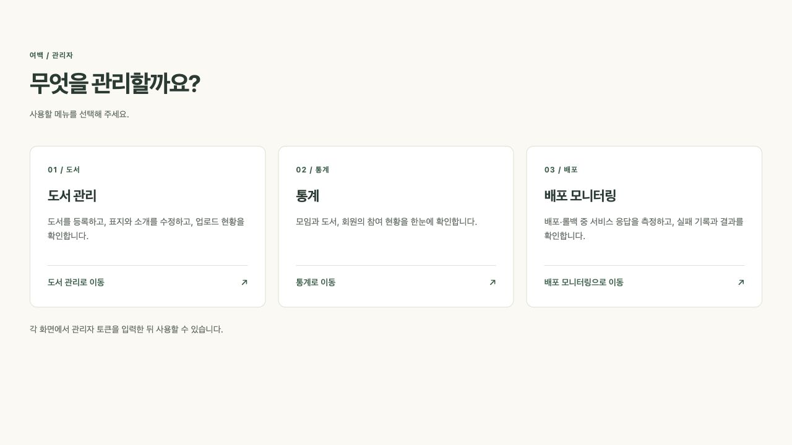
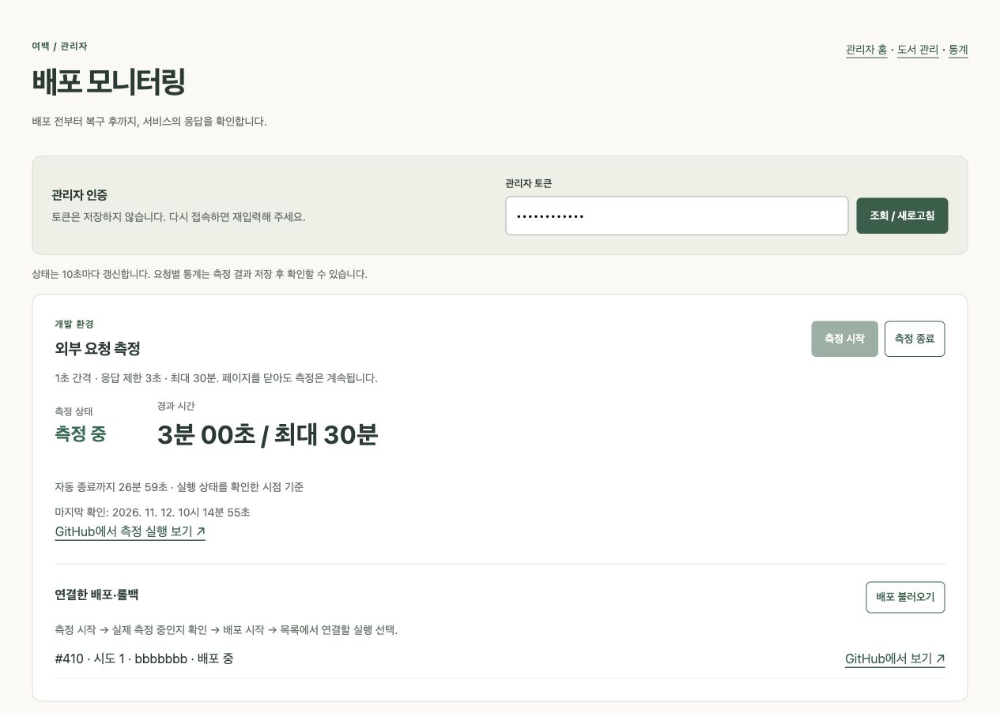
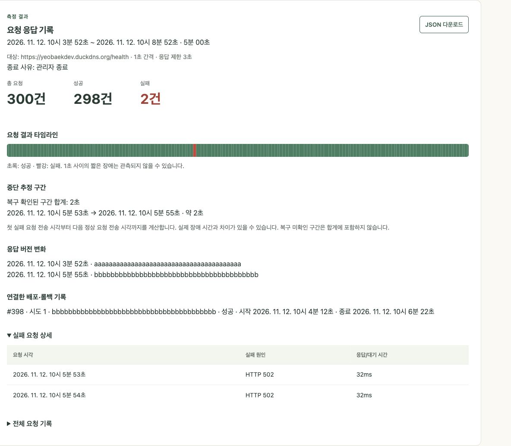

# 배포·롤백 외부 요청 측정

`/admin/deployment-monitoring`에서 관리자 토큰으로 인증하고 측정을 수동 시작한다.
GitHub 제공 Ubuntu 러너가 HTTPS `/health`를 요청한다. EC2와 브라우저에는 측정 결과를
영구 저장하지 않는다. 페이지를 닫아도 측정은 계속되며 재접속 후 관리자 토큰을 입력하면
GitHub에서 진행 중인 측정과 보관된 결과를 다시 조회한다.

## 사용 순서

1. **측정 시작**을 누르고 **측정 중**으로 바뀌는지 확인한다. Actions 실행 대기는 측정 시간이 아니다.
2. PR을 머지하거나 수동 배포를 시작한다.
3. **배포 불러오기**에서 시각·커밋·실행 번호를 확인하고 해당 배포를 연결한다.
   목록이 비어 있으면 같은 버튼으로 새로고침한다. 재실행은 실행 번호와 시도 번호를 함께 고정한다.
4. 별도 롤백 실행이 있으면 같은 측정에 추가로 연결한다. 이미 끝난 측정은 다시 열지 않는다.
5. 필요한 관찰을 마치면 **측정 종료**를 누른다. 종료 요청 전달 후 결과 저장을 기다린다.
6. 보관 중인 결과의 **결과 보기**에서 요청 통계·실패 구간·버전 변화를 확인하고 필요하면 JSON을 내려받는다.

한 환경에서는 측정 하나만 실행한다. 시작 버튼의 중복 요청은 기존 측정으로 연결한다.
러너에서도 환경별 concurrency와 중복 시작 검사를 적용하여 동시 시작 요청을 막는다.
측정 워크플로를 GitHub에서 재실행하지 말고 새 측정을 시작한다.

## 화면 예시

구현된 관리자 화면을 캡처했습니다. 측정 수치·커밋·실행 번호는 화면 설명을 위한 예시 데이터입니다.

<details>
<summary>관리자 메뉴 선택 화면</summary>



</details>

측정 중에는 측정 상태와 연결한 배포 상태를 함께 확인합니다.



측정 종료 후에는 요청 통계, 중단 추정 구간, 버전 변화, 배포 기록과 실패 요청 상세를 확인합니다.



## 측정과 종료 기준

- 1초마다 새 요청을 보낸다. 이전 요청이 늦어도 다음 요청을 기다리게 하지 않는다.
- 각 요청은 최대 3초 기다린다. 시간 안에 HTTP 200을 받으면 성공이다.
- 리다이렉트를 따라가지 않는다. 200 이외의 상태·연결 오류·시간 초과는 실패로 기록한다.
- `Deployed-Commit-SHA`는 버전 확인용이다. 헤더 누락 자체를 요청 실패로 계산하지 않는다.
- 캐시 재사용을 피하기 위해 요청별 쿼리 값과 `Cache-Control: no-cache, no-store`를 보낸다.
- 관리자 종료, 실제 측정 시작 후 30분, 연결한 모든 배포·롤백 종료 후 5분 중 먼저 도달한
  조건에서 새 요청을 멈춘다. 이미 보낸 요청은 각 3초 제한 안에서 마무리한 뒤 결과를 저장한다.
- 연결한 롤백이 실행 중이면 추가 관찰 5분 타이머를 해제하고, 롤백까지 끝난 뒤 다시 계산한다.
  전체 30분 제한은 연장하지 않는다.
- 배포를 연결하지 않으면 수동 종료와 30분 제한만 적용된다.
- 명령과 배포 상태를 러너가 10초마다 확인한다. GitHub 실행 대기·API 응답 지연 때문에
  종료/연결 버튼이 즉시 반영되지는 않는다. 5분 종료 시점도 상태 조회 지연의 영향을 받을 수 있다.
- 배포 상태 조회에 실패하면 완료로 추정하지 않는다. API 오류 횟수와 마지막 오류 시각을 결과에 남기며
  외부 요청은 계속한다. 관리 화면도 마지막 확인 시각과 상태 확인 불가를 구분한다.
- OS 스케줄링으로 예정한 시점의 요청을 보내지 못한 경우 `missedScheduledRequests`를 남긴다.
  이것은 서비스 요청 실패와 별개인 **측정 누락**이다.

## 기록과 해석

요청마다 전송 시각, HTTP 상태 또는 오류, 응답/대기 시간, 커밋 SHA를 저장한다.
요청 완료 순서가 달라도 전송 순서로 정렬해서 실패 구간을 계산한다.

**중단 추정 시간 = 연속 실패 구간의 첫 실패 요청 전송 시각부터 다음 정상 요청 전송 시각까지.**
복구를 확인한 구간만 합산한다. 끝까지 정상 응답이 없으면 `복구 미확인`으로 남기고
임의의 종료 시각을 만들어 합산하지 않는다. 1초 사이의 짧은 중단은 놓칠 수 있다.
실패 0건은 `측정한 요청에서 실패 없음`이며 서비스 전체 무중단의 절대 보증은 아니다.

배포 시작·완료 기록은 연결한 Actions 실행의 작업 시각을 기준으로 한다. HTTP 버전 전환은
실제 관측된 SHA로 별도 확인한다. 배포 작업이 성공해도 요청 실패가 있을 수 있다.
자동 복구가 배포 스크립트 안에서 실행됐다면 해당 배포 실행이 끝날 때까지 기다린다.
별도 롤백 실행의 시작·종료는 각각 연결해서 기록한다. 스크립트 내부의 세부 롤백 단계는
현재 Actions API만으로 분리하지 않으며, 해당 배포 스크립트의 기록을 함께 확인한다.

결과의 `controlErrors`가 있거나 측정 종료 직전 배포를 연결한 경우, 최종 배포 상태 기록이
일부 누락되거나 최신이 아닐 수 있다. 원래 Actions 실행과 대조한다.

## 저장과 정리

`deployment-monitor.yml`은 수동 시작과 명령 전달만 실행하며 배포 워크플로를 실행하거나 변경하지 않는다.

| 아티팩트 | 내용 |
| --- | --- |
| `ym-state-{환경}-{UUID}` | 실제 요청 시작 시각과 측정 설정 |
| `ym-command-{환경}-{UUID}-{명령실행ID}` | 종료 또는 배포 연결 명령 |
| `ym-result-{환경}-{UUID}` | 요약과 전체 요청 기록이 담긴 `result.json` |

GitHub를 명령·기록 보관소로 사용하므로 DB 테이블과 EC2 결과 폴더는 만들지 않는다.
관리 API는 GitHub 결과를 메모리에서 읽어 전달한다. GitHub 인증 토큰은 브라우저로 보내지 않는다.

새 결과 업로드가 성공하면 **같은 환경의 최신 측정 결과 20개**를 남긴다. 오래된 결과를 지울 때
그 측정의 시작·명령 아티팩트도 함께 삭제한다. Android/iOS 보고서·Docker 빌드 기록·다른 환경의
아티팩트는 정리 대상이 아니다. 새 결과 업로드 실패 시 정리를 실행하지 않는다.
아티팩트 기본 보관 기간은 90일이며 저장소/조직 상한 안에서 설정한다. 기간이 지나면 20개 이하라도
만료된다. 결과 없이 강제 취소된 측정의 임시 아티팩트도 보관 기한에 따라 만료된다.

**GitHub의 Cancel workflow는 관리자 화면의 측정 종료와 다르다.** 강제 취소·러너 장애에서는 결과
업로드를 보장할 수 없다. 이 경우 결과 없음으로 표시하며 실패 0건으로 바꾸지 않는다.

저장소가 공개이면 GitHub에서 접근 가능한 결과도 공개 범위에 영향을 받는다. 결과에는 관리자 토큰,
GitHub 토큰, 응답 본문을 넣지 않는다. 대상 URL에는 비밀 쿼리 값이나 인증 정보를 넣지 않는다.

## 개발 환경 준비

실제 서버 설정과 GitHub 설정은 자동으로 변경하지 않는다. 개발 환경에서 다음을 준비한다.

1. PR로 기본 브랜치 `develop`에 워크플로를 등록한다. `workflow_dispatch`는 기본 브랜치에
   워크플로가 있어야 사용할 수 있다.
2. 저장소 **Settings → Secrets and variables → Actions → Variables**에 설정한다.

   | 변수 | 개발 환경 값 |
   | --- | --- |
   | `MONITOR_DEV_HEALTH_URL` | `https://yeobaekdev.duckdns.org/health` |
   | `MONITOR_DEV_DEPLOY_WORKFLOWS` | 미설정이면 `backend-dev.yml`. 별도 롤백 파일은 쉼표로 추가 |
   | `MONITOR_RETENTION_DAYS` | 기본 `90`. 조직/저장소 보관 상한이 더 짧으면 그 이내로 설정 |

3. 여백 저장소만 대상으로 하는 GitHub 인증 토큰을 준비한다. **Actions: read and write**가 필요하다.
   가능하면 조직에서 승인한 GitHub App 설치 토큰 또는 만료일이 있는 fine-grained PAT를 사용한다.
   현재 앱은 환경변수의 토큰을 사용하므로 만료 시 갱신이 필요하다.
4. 개발 EC2의 Compose와 `.env`에 다음 값을 반영한다. 토큰은 Git에 커밋하지 않는다.

   ```dotenv
   MONITOR_GITHUB_TOKEN=실제_토큰
   MONITOR_GITHUB_REPOSITORY=woowacourse-teams/2026-yeobaek
   MONITOR_WORKFLOW_REF=develop
   MONITOR_DEPLOY_WORKFLOWS=backend-dev.yml
   ```

   저장소의 개발 Compose는 이 값을 Blue/Green 모두에 전달한다. `.env`만 수정하면 이미 실행 중인
   컨테이너에는 반영되지 않으므로 다음 안전한 배포에서 반영 여부를 확인한다.
5. 관리자 페이지에서 측정 시작, 새로고침 후 복원, 배포 연결, 종료, 결과 조회를 확인한다.
   다른 토큰으로는 조회·시작·종료·연결을 할 수 없는지도 확인한다.
6. 개발 배포·롤백을 측정하고 실제 요청 기록과 Actions 시각을 대조한다. 운영 적용은 이후 별도 작업이다.

운영용 URL은 기본값이 없으며 개발 URL이 없다고 운영 URL을 대신 사용하지 않는다.
운영에서 사용할 때에는 `MONITOR_ENVIRONMENT=prod`, `MONITOR_DEPLOY_WORKFLOWS=backend-prod.yml`,
GitHub 변수 `MONITOR_PROD_HEALTH_URL`·`MONITOR_PROD_DEPLOY_WORKFLOWS` 등을 별도로 설정한다.
이번 변경에서는 운영 Compose/배포 설정을 수정하지 않는다.

## 관리자 API

요청·응답과 상태별 화면 처리는 [API 명세의 배포·롤백 모니터링](../../docs/API.md#배포롤백-모니터링)을 따른다.
Swagger UI의 **관리자 배포 모니터링**에서도 필수 입력과 필드 의미를 확인할 수 있다.

## 애플리케이션 로그

관리자 페이지·API·서비스와 GitHub 클라이언트는 기존 구조화 로그 규칙을 따른다.
`operation`으로 작업을, `traceId`로 같은 HTTP 요청을, `session`·`deploymentRunId`·`attempt`로
측정과 배포를 연결한다. 시작 로그에는 `result`가 없고 완료 로그에만 `result=success`를 기록한다.
명령 전달 성공은 실제 측정 시작·종료가 아니라 **요청 전달 완료**를 뜻한다.
토큰, 요청·응답 전체, 다운로드 서명 URL은 로그에 넣지 않는다. 오류는 공통 예외 처리에서 기록한다.

## 검증

```bash
cd backend
PYTHONDONTWRITEBYTECODE=1 python3 -m unittest discover -s infra/monitoring/tests -v
node --test src/test/js/*.test.js
./gradlew build
```

외부 API는 테스트 대역을 사용한다. CI/로컬 테스트가 통과해도 실제 GitHub 권한·워크플로 등록·
아티팩트 업로드·개발 서버 연결은 위 준비 후 별도 확인해야 한다.

요구사항 증빙에는 prod URL, 측정·배포 구간, 커밋, 요청 수·실패 원인, 중단 추정 구간과 계산 방법을
문서로 남긴다. 개발 서버 기록만으로 prod 배포 측정 요구사항을 충족했다고 보지 않는다.
