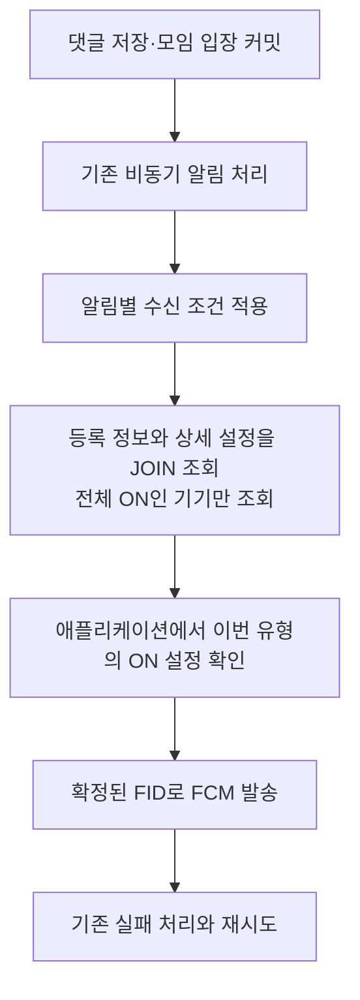
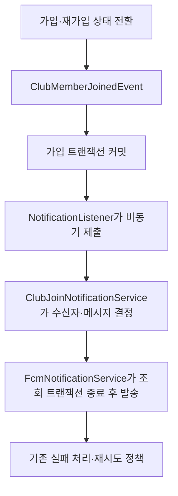

# 설치별 알림 설정

설정은 회원과 FID에 연결해요. 전체 알림이 ON이고 이번 알림 유형도 ON인 기기에 발송해요.
OS 알림 권한은 서버 설정과 별개이며, 서버에서 동기화하지 않아요.

## 저장과 등록

| 테이블 | 역할 |
|---|---|
| `notification_registrations` | 회원·FID와 전체 ON/OFF를 저장해요. `(member_id, fid)`는 유니크해요. |
| `notification_preferences` | 등록별 유형과 ON/OFF, 마지막 변경 시각을 저장해요. `(registration_id, notification_type)`는 유니크해요. |

최초 등록 시 `CLUB_JOIN`, `CLUB_COMMENT`, `PUBLIC_ROOM_COMMENT`를 모두 ON으로 생성해요.
재등록은 기존 설정을 유지해요. DB의 유니크 제약과 upsert로 동시 재등록도 한 행으로 처리해요.
유형별 설정 생성은 같은 트랜잭션에서 마쳐요.

JPA 연관관계는 `NotificationPreference → NotificationRegistration`의 단방향 `@ManyToOne`이에요.
등록 정보에는 설정 컬렉션과 `@OneToMany`를 두지 않아요. 설정 저장소에서 목록을 조회하고,
최초 등록 시에도 설정 행을 별도로 저장해요.

전체 OFF는 유형별 설정을 변경하지 않아요. 휴대폰의 설정 변경은 태블릿에 영향을 주지 않아요.
회원 삭제 시 모든 등록과 설정을 FK의 `ON DELETE CASCADE`로 함께 삭제해요.
`UNREGISTERED`로 특정 등록을 삭제할 때도 그 등록의 설정을 함께 삭제해요.
로그아웃 기능은 아직 없어요. 향후 구현 시 해당 설치의 등록을 삭제하는 흐름을 연결해야 해요.

## 최초 발송 흐름



모임·공개방의 후보 조회는 `CommentNotificationRecipientQueryRepository`에서 맡아요.
모임은 가입 상태·차단·읽기 진도 조건과 작성자 제외를 쿼리에 적용해 후보 회원 ID만 조회해요.
비교 기준은 이벤트에 담긴 문단 순서와 작성자 ID를 사용해요. 이를 얻기 위해 문장·문단·작성자를 다시 조회하지 않아요.
수신자들의 현재 읽기 진도는 계속 DB에서 조회해요.
공개방은 참여·같은 문장의 이전 댓글·차단 조건으로 후보 회원 ID만 조회해요.

두 경로 모두 후보 회원 ID 목록을 `NotificationRegistrationService.findByMemberIds()`에 전달해요.
`NotificationPreferenceRepository`가 전체 ON인 기기의 등록 정보와 모든 유형 설정을 한 SQL로 읽고,
`NotificationPreference.isNotificationAllowed()`에서 이번 유형과 ON/OFF를 확인해요.
통과한 설정의 등록 정보만 발송 대상으로 남겨요.
공개방도 후보 회원 조회와 기기 설정 조회를 나누므로, 이전보다 조회가 한 번 추가돼요.
대신 댓글 수신 조건과 기기 설정 조건을 서로 다른 저장소에서 일관되게 관리해요.

설정 JOIN 때문에 등록 정보와 설정을 각각 조회하지 않아요.
수신 후보를 구하는 기존 조회까지 포함해 전체 SQL이 한 번이라는 의미는 아니에요.
FCM 호출 전에 조회 트랜잭션을 끝내는 흐름도 유지해요.

재시도는 최초 확정한 등록 ID와 FID만 확인해요. 이후 전체·유형별 설정을 OFF해도 기존 작업은 유지해요.
등록이 삭제되거나 FID가 바뀐 경우의 기존 재시도 중단 조건은 유지해요.

## 설정 변경 책임

`NotificationPreferences`는 유형별 설정 목록만 보유하는 일급 컬렉션이에요.
목록에 다른 등록의 설정이 섞이면 거부하며, 유형에 맞는 설정 찾기와 전달된 유형별 변경을 처리해요.
전체 ON/OFF는 `NotificationRegistration`이 관리해요.
`NotificationRegistrationService`는 회원·FID에 해당하는 등록을 조회해요.
`NotificationPreferencesService.findPreferences(registration)`가 해당 등록의 상세 설정을 직접 조회해요.
설정 서비스는 두 객체를 별도로 조작하며 하나의 트랜잭션으로 묶어요.

설정 API는 회원·FID로 등록을 확인한 뒤, 그 등록 ID의 상세 설정을 조회해요.
정상 조회·변경에 SQL 두 번을 사용해요. 상세 설정의 첫 항목에서 등록을 역으로 찾지 않아요.
발송용 조회는 기존처럼 등록과 설정을 JOIN해요.

```text
PATCH 요청 DTO → 변경할 유형과 값의 Map
NotificationPreferencesService → NotificationRegistrationService.find(memberId, fid)
→ NotificationPreferencesService.findPreferences(registration)
NotificationRegistration → 전체 설정 변경
NotificationPreferences → 전달된 유형만 변경
```

새 유형을 추가해도 서비스에 유형별 변경문을 추가하지 않아요.
기존 JSON 계약을 유지하므로 요청·응답 DTO의 필드와 유형 연결은 추가해야 해요.

## 모임 입장 알림

최초 가입과 탈퇴 후 재가입에 `ClubMemberJoinedEvent`를 발행해요.
이미 가입 중인 회원의 중복 입장 요청과 모임 생성자의 최초 자동 참여에는 발행하지 않아요.
기존 참여 정보는 잠금을 요청하지 않는 일반 조회로 읽어요. 동시 재가입 요청이 모두 탈퇴 상태를 읽으면
각각 입장 이벤트를 발행할 수 있어, 동시 요청에 대한 알림 중복 방지는 보장하지 않아요.



수신자는 워커 조회 시점에 가입 중인 구성원이에요. 입장자 본인, 탈퇴자, 입장자를 차단한 수신자를 제외해요.
전체 알림과 `CLUB_JOIN`이 모두 ON인 기기를 선택하며, 읽기 진도는 조건에 포함하지 않아요.

FCM의 제목은 `새로운 모임원이 참여했어요!`, 본문은 `모임에서 함께 이야기를 나눠 보세요.`예요.
데이터는 아래처럼 전송해요. 알림을 눌렀을 때 모임으로 이동하는 처리는 앱에서 이 계약을 사용해야 해요.

```json
{"type": "CLUB_JOIN", "clubId": "5", "memberId": "7"}
```

최초 발송 이후 최대 5회 추가 시도하고 입장 시각으로부터 30분이 지나면 종료해요.
접수 불명확은 최대 1회 추가 시도하며, `Retry-After`와 기존 백오프를 적용해요.
재시도는 처음 선정한 등록 ID·FID를 유지해요. 이후 설정을 OFF해도 이미 선정된 작업은 유지해요.

댓글과 입장 알림은 `FcmNotificationService`의 발송·실패·재시도 생성을 공유해요.
`FcmRetryTask`는 `notificationType`, `sourceId`, `createdAt`으로 발생 원인을 보관해요.
댓글은 댓글 ID, 모임 입장은 모임 ID를 사용하고 로그에도 각각 `commentId`, `clubId`로 기록해요.
기존 댓글 로그의 `operation`은 유지하고 입장 로그는 `notification.clubJoin.*`를 사용해요.

가입 롤백 시 제출하지 않으며, 알림 실패나 실행기 포화로 가입 결과를 되돌리지 않아요.
메모리 작업이므로 서버 종료 시 대기·재시도 작업이 유실될 수 있는 기존 한계는 유지해요.
`CLUB_JOIN` 설정과 테이블은 이미 있어 이번 발송 연결에 추가 DDL은 필요하지 않아요.

## API

기존 등록 API의 요청과 응답은 유지해요. 설정은 아래 API로 조회·변경해요.

```http
GET /api/notifications/preferences?fid={FID}
X-Member-Id: 10
```

```json
{"enabled": true, "clubJoin": true, "clubComment": true, "publicRoomComment": false}
```

```http
PATCH /api/notifications/preferences?fid={FID}
X-Member-Id: 10
Content-Type: application/json

{"enabled": false, "clubComment": false}
```

생략하거나 null인 항목은 유지해요. PATCH 성공 응답은 `204`예요.
조회·변경은 회원과 FID를 함께 확인해요. 다른 회원의 등록이나 존재하지 않는 등록은
`400 NOTIFICATION_REGISTRATION_NOT_FOUND`로 응답해요.

## 마이그레이션과 유형 추가

[V6](../src/main/resources/db/migration/V6__create_notification_preferences.sql)는 기존 V1~V5를 수정하지 않고 추가해요.

1. 기존 동일 회원·FID의 중복은 가장 오래된 등록 ID 하나를 남겨요. 다른 회원의 같은 FID는 유지해요.
2. 전체 설정과 유니크 제약을 추가하고, 회원 삭제 시 등록을 함께 삭제하도록 FK를 변경해요.
3. 유형별 설정 테이블을 만들고 기존 모든 등록에 세 유형을 ON으로 채워요.

앱 기동 시 Flyway가 V6를 적용하고 Hibernate `validate`로 매핑을 확인해요.
다음 유형을 추가할 때는 enum과 API 필드뿐 아니라 **기존 모든 등록에 새 유형을 ON으로 넣는 다음 버전 마이그레이션**도 추가해야 해요.
이미 적용한 V6를 수정하거나, 없는 설정을 임의로 ON으로 해석하는 방식은 사용하지 않아요.

## 적용 범위

- 모임 입장·모임 댓글·공개방 댓글 알림에 설정을 적용해요.
- `CLUB_JOIN` 설정을 모임 최초 가입과 재가입 알림에 적용해요.
- 재시도 예약·실행 방식과 메모리 작업 유실 가능성 등 기존 구조의 한계는 유지돼요.
- 앱 화면과 OS 권한 연동은 변경하지 않아요.

API 계약은 [API 명세](../../docs/API.md#11-설치별-알림-설정)에 정리해요.
